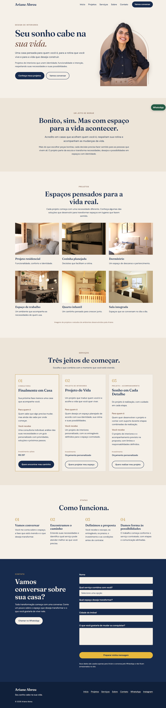

# Site Ariane Abreu | Design de Interiores

Landing page responsiva para uma designer de interiores, com apresentação dos serviços, portfólio de projetos e contato direto pelo WhatsApp.

**Site no ar:** [arianeabreuinteriores.com.br](https://arianeabreuinteriores.com.br)

## Capturas de tela

<table>
  <tr>
    <th align="center">Computador</th>
    <th align="center">Celular</th>
  </tr>
  <tr>
    <td valign="top" width="65%">
      
    </td>
    <td valign="top" width="35%">
      
    </td>
  </tr>
</table>

## Sobre o projeto

A Ariane é designer de interiores e precisava de uma página simples e acolhedora para apresentar o trabalho dela, mostrar os serviços e valores e levar o cliente para o atendimento pelo WhatsApp.

O projeto foi desenvolvido a partir de um documento de referência passado por ela, com textos, identidade visual (paleta de cores e tipografia) e a estrutura de seções desejada.

## Funcionalidades

- Layout responsivo, pensado primeiro para celular (mobile first).
- Menu fixo no topo, com versão hambúrguer no celular.
- Seções: abertura, filosofia, portfólio, serviços, como funciona e contato.
- Portfólio com grade de projetos (1, 2 ou 3 colunas conforme a tela).
- Cards de serviços com destaque para a oferta de entrada.
- Formulário de contato que valida os campos e monta a mensagem para o WhatsApp, sem backend e sem armazenar dados.
- Botões de WhatsApp com mensagem pré-preenchida e botão flutuante que se esconde na área de contato.
- Animações discretas de entrada, desativadas para quem prefere menos movimento (`prefers-reduced-motion`).
- Acessibilidade: link para pular o conteúdo, foco visível, rótulos nos campos, hierarquia de títulos.
- SEO e compartilhamento: meta tags, Open Graph, dados estruturados (JSON-LD) e URL canônica.
- Modal de detalhes dos projetos já implementado, desativado por uma constante (`MODAL_PROJETOS_ATIVO`) até os textos ficarem prontos.

## Tecnologias

- HTML, CSS e JavaScript puros (sem frameworks e sem etapa de build)
- Google Fonts: Fraunces e DM Sans
- Git e GitHub
- GitHub Pages, com domínio próprio e HTTPS (DNS configurado no Registro.br)

## Estrutura do projeto

```
site-ariane/
├── index.html
├── css/
│   └── style.css
├── js/
│   └── main.js
├── img/
├── docs/          (capturas de tela do README)
└── CNAME          (domínio próprio do GitHub Pages)
```

## Como rodar localmente

Não precisa instalar nada. Clone o repositório e abra o `index.html` no navegador:

```bash
git clone https://github.com/natangadonski/site-ariane.git
cd site-ariane
```

Durante o desenvolvimento, usei a extensão **Live Server** do VS Code, que recarrega a página a cada alteração.

Depois acesse `http://localhost:8000`.

## Como foi feito

- **Requisitos:** definidos a partir do documento de referência da cliente (textos, seções, identidade visual).
- **Código:** gerado e iterado com o Codex, um assistente de código com IA, em etapas curtas, uma seção por vez. Usei também o Claude para planejar as etapas e organizar os prompts.
- **Revisão e ajustes:** revisei o código gerado e fiz alterações manuais.
- **Versionamento:** todos os commits foram feitos por mim.
- **Publicação:** GitHub Pages com domínio próprio, incluindo a configuração de DNS (registros A, CNAME e TXT) e HTTPS.

## Próximos passos

- Preencher os textos do modal de cada projeto e reativá-lo.
- Incluir os links das redes sociais.
- Adicionar imagem de compartilhamento (`og:image`).

## Autor

Natan Gadonski, estudante de Ciência da Computação.

- GitHub: (https://github.com/natangadonski)
- LinkedIn: (https://www.linkedin.com/in/natangadonski/)

## Observação sobre o conteúdo

Textos, fotos e imagens dos projetos pertencem à Ariane Abreu e estão publicados com a autorização dela.
